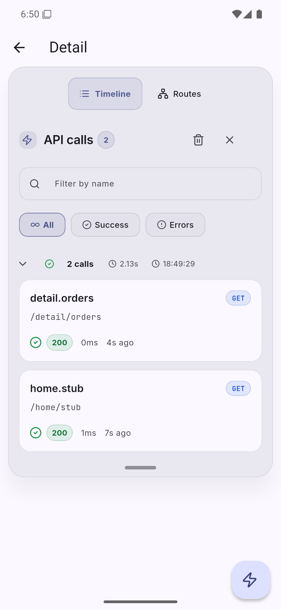
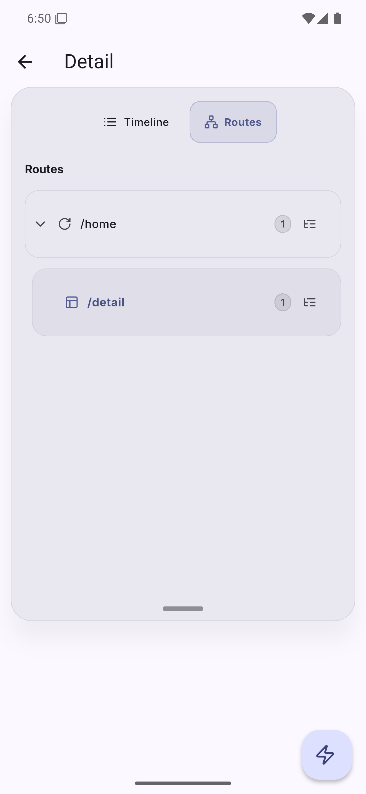
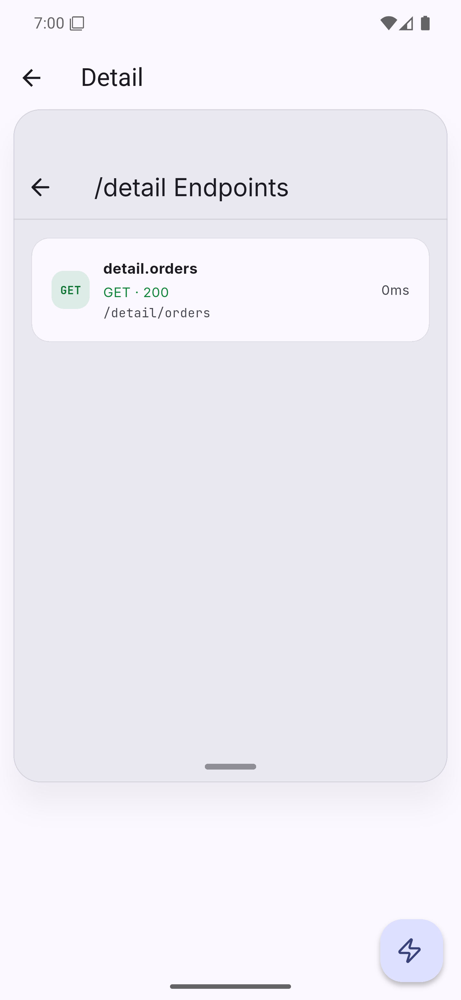

# flutter_api_inspector

[](https://flutter.dev)
[](https://dart.dev)

<p align="center">
  
  
  
</p>

[Request detail screenshot](assets/demo-detail.png) · [Capture provenance](assets/README.md)

Debug-first in-app overlay that intercepts HTTP traffic and shows a
live timeline with status codes, durations, and response bodies —
without leaving the app, without proxy certificates, and without
modifying a single API call.

By default, the overlay is guarded by `kDebugMode` and omitted from
normal release usage. You can opt into controlled QA builds with
`ApiTrace.forceEnabled`; route-scoped tracking and route endpoint panels
remain debug-only in the current implementation.

## Why

When an endpoint misbehaves (wrong status, slow response, unexpected
body), Flutter developers waste time sprinkling `debugPrint` calls,
rebuilding, and reading scrolling console output. There is no in-app
visualization that shows "the last N calls, in order, with the bodies
I care about."

`flutter_api_inspector` fills that gap with a floating action button
that opens a timeline panel inside your running debug app.
The Breathing Room layout uses spacious request cards, rounded controls,
and softer surfaces inherited from your app's light or dark `ColorScheme`.
The screenshots above show the current inspector running in the Android example app.

## Third-party assets

Inspector icons use a bundled Lucide subset (ISC); interface and technical text
use bundled Inter and JetBrains Mono subsets (SIL OFL). No runtime downloads or
additional package dependencies are required. Host colors and typography outside
the inspector are preserved. See [asset sources and licenses](third_party/README.md).

## Quickstart

Add the dependency:

```yaml
dependencies:
  flutter_api_inspector: ^0.4.0
```

### Option A — Automatic capture (recommended)

Install `TracedHttpOverrides` once in `main()`. It intercepts every
`dart:io HttpClient` constructed anywhere in the process — this covers
`GetConnect`, `package:http`, `Dio`, and any other client that uses
`dart:io` under the hood:

```dart
import 'dart:io';
import 'package:flutter_api_inspector/flutter_api_inspector.dart';

void main() {
  HttpOverrides.global = TracedHttpOverrides();
  ApiTrace.runApp(const MyApp());
}
```

One import covers everything — overlay, manual API, and both
interceptors. The package targets mobile / desktop, where there is
no browser console; on Flutter Web use the browser's own DevTools
Network tab instead.

Every HTTP call your app makes will appear in the overlay with its URL,
method, status code, duration, and response body. For a wrapped `MyApp`
that builds its own `MaterialApp`/`GetMaterialApp`, use the explicit
[host integration](#host-popup-priority) below so inner popups take priority.

### Option B — Manual instrumentation

Wrap individual calls with `ApiTrace.call(...)` for fine-grained
control over what is captured and what label appears in the timeline:

```dart
import 'package:flutter_api_inspector/flutter_api_inspector.dart';

await ApiTrace.call(
  'POST authenticator/v2',
  method: 'POST',
  url: Uri.parse('$baseUrl/pxauth/authenticator/v2'),
  execute: () async {
    final res = await post(url, body, contentType: 'application/json');
    return ApiTraceResponse(
      statusCode: res.statusCode ?? 0,
      responseBody: res.bodyString,
    );
  },
);
```

### Option C — Dio interceptor

If you use [Dio](https://pub.dev/packages/dio) and want per-instance
control, add `TracedDioInterceptor` instead of (or alongside)
`TracedHttpOverrides`:

```dart
import 'package:dio/dio.dart';
import 'package:flutter_api_inspector/flutter_api_inspector.dart';

final dio = Dio()..interceptors.add(TracedDioInterceptor());
```

Installing both is safe: on mobile/desktop Dio routes through
`dart:io HttpClient`, so `TracedDioInterceptor` detects that
`TracedHttpOverrides` is active and defers to it automatically —
each call is recorded exactly once. If your Dio instance uses a
custom `HttpClientAdapter` that bypasses `dart:io` (mocks, http2),
pass `TracedDioInterceptor(deferToHttpOverrides: false)` so the
interceptor records those requests itself.

> **Note:** Both interceptors are exported from the main barrel
> (`flutter_api_inspector.dart`). `dio` is a transitive dependency
> of this package regardless of which interceptor you use. If you
> only need `TracedHttpOverrides` and want to avoid pulling in
> `dio`, import directly from
> `package:flutter_api_inspector/interceptor/http_overrides.dart`.

## Host popup priority

The inspector is **nonmodal**: touches outside its panel/FAB reach your
app and leave the panel open. Close it with **X** or the **FAB**. Opening
it never clears active or queued host SnackBars.

Dialogs, popup menus/dropdowns and modal bottom sheets temporarily hide
and disable the whole inspector, including keyboard focus, until their
exit transitions finish. The open panel, filters, tab, detail navigation,
launcher position and panel height survive; capture continues meanwhile.

| App structure | Integration |
|---|---|
| `ApiTrace.runApp(MaterialApp(...))` | Automatic popup observer and host; existing builder and observers are preserved. |
| `ApiTrace.runApp(MyApp())` with an inner app | Still supported, but cannot observe the inner Navigator automatically. Use the explicit integration below instead for inner popup priority. |
| `MaterialApp.router` or router-owned Navigators | Explicit host plus observer on the actual Navigator; the bootstrap cannot inject observers into a router. |

### Wrapped MyApp / GetMaterialApp

Keep startup, capture, services, authentication and QA flags unchanged.
Replace only the launch call:

```dart
// Before: ApiTrace.runApp(MyApp(initialWidget: fastInitialWidget));
runApp(MyApp(initialWidget: fastInitialWidget)); // Flutter's ordinary runApp
```

Own one stable popup observer in your existing `_MyAppState`. Keep the
existing `MultiProvider`/`LoginProvider` wrappers around `GetMaterialApp`.
Add the observer to the existing list, and wrap the **existing builder
result** rather than replacing it:

```dart
// In _MyAppState (not inside build):
final _inspectorObserver = ApiTraceNavigatorObserver();

@override
void dispose() {
  _inspectorObserver.dispose();
  super.dispose();
}

// Inside your existing GetMaterialApp constructor:
navigatorObservers: [
  RouteStackObserver(),
  loginRouteObserver,
  _inspectorObserver,
],
builder: (context, child) => ApiTraceHost(
  observer: _inspectorObserver,
  child: EnvironmentBanner(
    child: Stack(
      children: [
        child!,
        const AppLoadingOverlay(),
      ],
    ),
  ),
),
```

Merge disposal with any existing `dispose` cleanup. Do not create the
observer in `build`, dispose it from the host, mutate an existing observer
list, or also wrap this explicit integration in `ApiTrace.runApp` (that
would mount two inspectors). The popup observer does not replace capture's
`RouteScopeObserver`; if you already use one, keep that same instance.
For route-scoped capture with explicit integration, add one stable
`RouteScopeObserver` to the actual Navigator if none is installed.

This recipe mirrors the supplied appcomercios builder/observer excerpts;
equivalent wrapped Flutter Navigators are widget-tested here. The actual
appcomercios/Get runtime is **not tested**: its source and Get dependency
are not part of this package.

### Router-owned Navigator

Use ordinary Flutter `runApp`, own/dispose the same stable observer as
above, and connect both ends explicitly:

```dart
// In your RouterDelegate.build (or the router's observer configuration):
Navigator(
  key: navigatorKey,
  observers: [existingObserver, inspectorObserver],
  pages: pages,
  onDidRemovePage: onDidRemovePage,
);

// In the actual MaterialApp.router:
builder: (context, child) => ApiTraceHost(
  observer: inspectorObserver,
  child: existingBuilder(context, child), // retain existing wrappers
),
```

The observer must belong to the Navigator that pushes the host popups.
For nested Navigators, wire the host to the popup-owning Navigator; an
outer bootstrap does not discover inner routes. No host route is popped,
removed or replaced by the inspector.

## Route-Scoped Network Inspector

_New in 0.3.0._ The overlay correlates every HTTP call with the
Flutter screen (route) that was active when it was dispatched, so
instead of a flat chronological timeline you get: "CheckoutScreen →
POST /orders (500) → GET /payment-methods (timeout)".

When passed a direct `MaterialApp`, `ApiTrace.runApp` auto-injects a
`RouteScopeObserver` into its `navigatorObservers` (debug-only, no setup
required). Wrapped and router-owned Navigators need explicit wiring.
`TracedHttpOverrides` and `TracedDioInterceptor` automatically tag
every request with the active route's `scopeId` and name.

Open the overlay panel and switch to the **Routes** tab to:

- Browse a hierarchical tree of every screen visited this session
  (indented by navigation depth, with call/error counts per screen).
- Tap a screen to filter the Timeline tab down to just its calls,
  with timestamps shown relative to screen entry (`+230ms`, `+1.4s`).
- Open a route's endpoint list from the `list_alt` / **View endpoints**
  action; the `<routeName> Endpoints` panel lists each endpoint, and
  tapping one opens its `ApiTraceDetailScreen`.
- Export just that screen's calls as cURL (`Copy as cURL` includes a
  `// Route: <name> (scopeId: <id>)` header).

### `MaterialApp.router` users

The auto-injection only wires into `BootstrapMaterialAppHarness`'s
own `MaterialApp`. If your app uses `MaterialApp.router` (go_router,
auto_route, etc.), add `RouteScopeObserver` to your router's
`observers` list yourself:

```dart
GoRouter(
  observers: [RouteScopeObserver()],
  routes: ...,
);
```

### Manual instrumentation + route scoping

If you call `ApiTrace.call(...)` directly instead of using an
automatic interceptor, tag it yourself by reading `RouteScope.current`
and forwarding it through `extra` — the same convention the built-in
interceptors use internally:

```dart
final scope = RouteScope.current;
await ApiTrace.call(
  'orders.create',
  method: 'POST',
  url: Uri.parse('$baseUrl/orders'),
  extra: <String, Object?>{
    if (scope != null) 'routeScopeId': scope.scopeId,
    if (scope != null) 'routeName': scope.routeName,
  },
  execute: () async => ApiTraceResponse(statusCode: 201),
);
```

Read the scope data back off any record via the `ApiTraceRecordScope`
extension: `record.routeScopeId` / `record.routeName` (both `null` for
calls made before route tracking was active, or for legacy records).

Route names come from `Route.settings.name`, falling back to
`route.runtimeType.toString()` for unnamed routes — name your routes
for readable labels in the Routes tab.

## Public API surface

```dart
// Master switch + global config.
ApiTrace.enabled;            // bool, defaults to kDebugMode
ApiTrace.config;             // ApiTraceConfig, mutable
ApiTrace.timeline;           // in-memory ring buffer (Timeline)

// Capture one call manually.
Future<String?> ApiTrace.call(
  String name, {
  required String method,
  required Uri url,
  required Future<ApiTraceResponse> Function() execute,
  Set<ApiTraceDetail>? detailOverride,
  Map<String, Object?>? extra,
});

// One-line bootstrap.
ApiTrace.runApp(Widget app);

// Explicit actual-Navigator integration (see "Host popup priority").
ApiTraceNavigatorObserver(); // stable popup observer, caller owns disposal
ApiTraceHost(observer: observer, child: existingBuilderResult);

// Route-scoping (see "Route-Scoped Network Inspector" above).
RouteScope.current;          // RouteScopeEntry? — the active screen's scope
RouteScope.entries;          // List<RouteScopeEntry> — current route-flow history
RouteScopeObserver();        // NavigatorObserver, for MaterialApp.router
record.routeScopeId;         // int? — via the ApiTraceRecordScope extension
record.routeName;            // String?
```

## Configuration

All fields are optional — `const ApiTraceConfig()` gives the package
defaults:

```dart
ApiTrace.config = const ApiTraceConfig(
  // Which fields to capture on every call.
  // Default: {minimal, response} — captures status/duration/url
  // plus the response body so failed calls are immediately readable.
  details: {ApiTraceDetail.minimal, ApiTraceDetail.response},

  // Overlay FAB position: bottomRight | bottomLeft | topRight | topLeft.
  overlayPosition: ApiTraceOverlayPosition.bottomRight,

  // FAB label: icon (default) | badge (count) | chip (text + count).
  overlayLabel: ApiTraceOverlayLabel.icon,

  // Whether the FAB can be dragged around the screen. Default true.
  draggableFab: true,

  // Gap between two calls before the panel groups them separately.
  // Set to Duration.zero to disable grouping.
  flowGroupGap: Duration(seconds: 2),

  // Timeline panel height range (logical pixels).
  panelMaxHeight: 600,
  panelMinHeight: 360,

  // Max bytes stored per response body (truncated beyond this).
  maxResponseBodyBytes: 4096,

  // Ring buffer capacity (oldest record evicted when full).
  timelineCapacity: 200,
);
```

## Release-mode testing (force enable)

By default the overlay is guarded by `kDebugMode` for normal release
builds. When you need controlled QA coverage in a release build — e.g.
for a tester flavor or a feature-flag-gated development module — set
`ApiTrace.forceEnabled = true` **before** calling `ApiTrace.runApp()`:

```dart
void main() {
  if (moduloDesarrollo.isHabilitado) {
    ApiTrace.forceEnabled = true;
  }
  HttpOverrides.global = TracedHttpOverrides();
  ApiTrace.runApp(const MyApp());
}
```

The effective value of `ApiTrace.enabled` is `_enabled || forceEnabled`.
To temporarily disable the overlay on a force-enabled build, set both
`forceEnabled = false` and `enabled = false`.

`forceEnabled` constructs the `ApiTrace.runApp` bootstrap and overlay for
QA builds. Route-scoped tracking (`RouteScope.init()`) and the route
endpoint panel are still guarded by `kDebugMode`, so release-mode QA
builds should not rely on Routes tab endpoint drill-downs.

### Detail levels

| Value | Captures |
|-------|----------|
| `minimal` | URL, method, status code, duration (always on) |
| `response` | Response body (truncated to `maxResponseBodyBytes`) |
| `request` | Request body |
| `headers` | Request + response headers |
| `full` | Everything above |

## `TracedHttpOverrides` — how it works

`TracedHttpOverrides` replaces `HttpClient.createHttpClient` globally
(via `HttpOverrides.global`). Every `HttpClient` created anywhere in
the process — including inside `GetConnect`, `package:http`, and Dio's
default adapter — goes through `TracedHttpClient`.

When a request is closed, the wrapper:

1. Captures the request body bytes as the caller writes them (only
   when the detail set includes `request` or `full`, capped at
   `maxResponseBodyBytes`).
2. Reads the full response body into memory (up to `maxResponseBodyBytes`
   for the inspector; the complete body is replayed transparently to the
   caller).
3. Completes the `ApiTrace` record with status code, request/response
   headers, and decoded bodies.
4. Returns a `_ReplayHttpClientResponse` so the caller receives every
   byte unchanged.

The interception is transparent: `GetConnect`, `http`, and Dio see no
difference in the response they receive.

**Limitations of `TracedHttpOverrides`:**

- Mobile and desktop only (`dart:io`). Flutter Web uses `XMLHttpRequest`;
  install `TracedHttpOverrides` conditionally with `!kIsWeb`.
- Eagerly buffers the full response before returning it to the caller.
  This is a non-issue for REST API payloads; avoid it for large file
  downloads in debug mode.
- Dio with a custom `HttpClientAdapter` (e.g. mocks) bypasses
  `dart:io` entirely — use `TracedDioInterceptor` in that case.

## Limitations

- **Debug-first.** Normal release builds leave tracing disabled, and
  `ApiTrace.call` is a no-op when `ApiTrace.enabled` is false (the
  default in release). `ApiTrace.forceEnabled` is intended for controlled
  QA builds, not production diagnostics.
- **Route tooling is debug-only today.** Route-scoped tracking and the
  route endpoint panel are guarded by `kDebugMode`; force-enabled release
  builds can show the overlay, but should not depend on Routes tab
  endpoint drill-downs.
- **In-memory only.** The ring buffer resets on every app restart.
  No disk persistence, no file export in v1.
- **Read-only detail view.** No re-run, no replay. cURL export exists
  only when filtered to a specific route in the Routes tab (see
  "Route-Scoped Network Inspector" above) — there is no export for
  the full, unfiltered timeline in v1.
- **No Flutter Web support.** Web is intentionally out of scope: the
  browser's DevTools Network tab already covers it. This package
  exists for mobile / desktop, where there is no console. The
  pubspec declares `platforms:` accordingly, so pub.dev shows web
  as unsupported.
- **Single overlay per app.** Multi-window is out of scope for v1.

## License

MIT — see [LICENSE](LICENSE).
